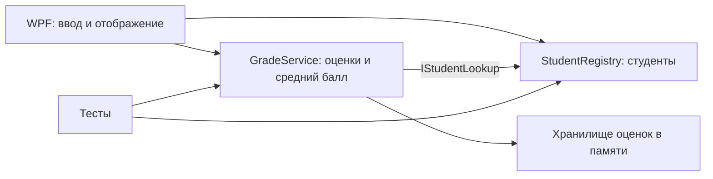

# Архитектура и реестр артефактов

## Исходное состояние

На момент начала работы `main` указывает на `989e08e`: это пустой шаблон WPF на .NET Framework 4.8. Окно не содержит функциональности, README пуст. Далее описан **план**; реализация появится в следующих этапах.

## Назначение и границы

Учебное настольное приложение учитывает студентов и их оценки: добавление студента, ввод оценки по предмету, просмотр оценок и среднего балла. Данные первой версии существуют только в памяти процесса; после закрытия приложения они теряются. Пользователей, разграничения прав, сети, журналирования персональных данных, импорта и многопользовательской работы нет. Не использовать реальные персональные данные.

## Реестр артефактов

| Артефакт | Назначение | Состояние на этапе 1 |
|---|---|---|
| `docs/architecture.md` | Границы, модули, зависимости, решения | Создан |
| `docs/contracts.md` | Два контракта взаимодействия | Создан |
| `docs/stages/` | Отчёты по этапам и результаты проверок | Начато |
| `docs/version-control.md` | Правила работы с Git | Планируется на этапе 2 |
| `README.md` | Сборка, запуск и проверка | Планируется обновление |
| `StudentRecords.Core/` | Модели, реестр студентов и оценки | Планируется |
| `student-records-and-grades-system/` | Существующее окно WPF | Планируется адаптация |
| `StudentRecords.Tests/` | Модульные и интеграционные тесты | Планируется |
| `.gitignore`, `.editorconfig` | Фильтрация и единый стиль | Планируется ревизия |

## Модули и схема

- **StudentRegistry** отвечает за регистрацию и поиск студентов, не знает об интерфейсе.
- **GradeService** валидирует оценку, проверяет существование студента через контракт `IStudentLookup`, сохраняет запись и вычисляет среднее.
- **WPF** принимает ввод, вызывает сервисы и показывает результат; не содержит правил расчёта.
- **Тесты** проверяют модули и границу между ними.

## Зависимости

Внутренние: WPF → Core; GradeService → `IStudentLookup`; тесты → Core. Обратных ссылок Core на WPF нет. Внешние: .NET SDK 9, Windows Desktop Runtime 9 и Windows для запуска WPF; пакеты тестового фреймворка будут зафиксированы в проектах тестов. Git нужен для истории. Разработка ведётся без внешней базы и веб-API.

## Сборка и запуск: целевое состояние

После реализации: `dotnet restore`, `dotnet build`, `dotnet test`; запуск WPF из Windows командой `dotnet run --project student-records-and-grades-system`. На Linux сборка Windows-проекта требует `EnableWindowsTargeting`; само WPF-окно там не запускается. До реализации эти команды не являются подтверждением работоспособности системы.

## Стратегия тестирования

Проверять корректное и некорректное создание студента и оценки, существование студента, вычисление среднего, пустой набор оценок. Интеграционный тест создаёт студента в реестре и передаёт его идентификатор сервису оценок; отрицательный сценарий использует неизвестный идентификатор. UI проверяется вручную на Windows; автоматические тесты не заменяют эту проверку.

## Правила работы с Git

Отдельная основная ветка для каждого этапа `stage/NN-*`; в этапе 3 для имитации команды создаются дополнительные ветки модулей. Каждое логическое изменение фиксируется отдельным коммитом. Подробные правила и результаты учебного конфликта - в этапе 2.

## Журнал решений

| ID | Решение и причина | Последствие |
|---|---|---|
| ADR-001 | Сохранить настольный WPF и перевести шаблон на .NET 9: это учитывает существующий проект и стек задания. | Запуск UI требует Windows; Linux способен проверять только сборку и кроссплатформенное ядро. |
| ADR-002 | Разделить реестр студентов и оценки контрактом поиска студента. | Границу можно тестировать без WPF. |
| ADR-003 | Первая версия хранит данные в памяти. | Приложение учебное: данные не сохраняются после завершения. |
